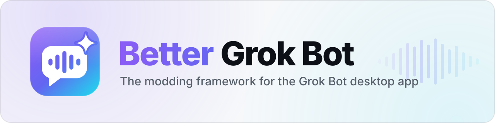
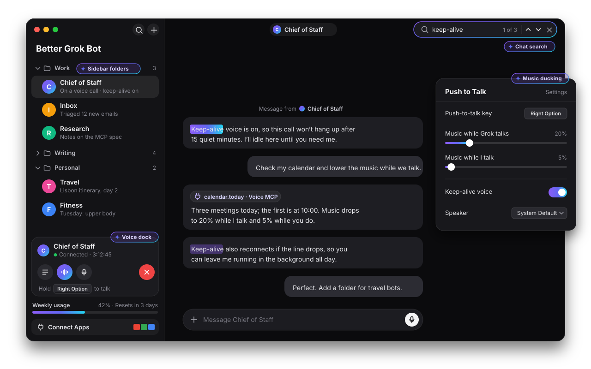
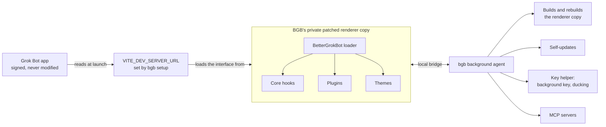

<p align="center">
  <picture>
    <source media="(prefers-color-scheme: dark)" srcset="docs/assets/banner-dark.svg">
    <source media="(prefers-color-scheme: light)" srcset="docs/assets/banner-light.svg">
    
  </picture>
</p>

<p align="center">
  <a href="https://github.com/Unravl/better-grok-bot/actions/workflows/ci.yml"></a>
  <a href="https://github.com/Unravl/better-grok-bot/actions/workflows/release.yml"></a>
  <a href="https://github.com/Unravl/better-grok-bot/actions/workflows/canary.yml"></a>
  <a href="https://github.com/Unravl/better-grok-bot/releases/latest"></a>
  <a href="https://github.com/Unravl/better-grok-bot/releases"></a>
  <a href="LICENSE"></a>
  <a href="#verified-on"></a>
  <a href="https://bun.sh"></a>
  <a href="https://www.typescriptlang.org"></a>
</p>

<p align="center">
  <b>The modding framework for the <a href="https://x.ai/bot">Grok Bot</a> desktop app, like BetterDiscord is for Discord.</b><br>
  The stock app lacks a lot of settings. Better Grok Bot (BGB) sits on top of it and adds plugins, themes and hooks<br>
  on macOS, Windows and Linux, without modifying the app's files.
</p>

<p align="center">
  <a href="#features">Features</a> ·
  <a href="#install">Install</a> ·
  <a href="#how-it-works">How it works</a> ·
  <a href="#plugins">Plugins</a> ·
  <a href="#themes">Themes</a> ·
  <a href="#safety">Safety</a>
</p>

<p align="center">
  
</p>

BGB is one command-line program, `bgb`, plus a small background agent. Install it once, then open Grok Bot the way
you always do: BGB loads its plugins and themes into the app and adds a **Better Grok Bot** section to
**Settings → General**, where you manage everything.

## Features

### Voice

| | Feature | What it does | Where |
|---|---|---|---|
|  | **Push to talk** | Hold one key (default Right Option / Right Alt) or the call's talk button to speak; letting go ends your turn so Grok answers right away. With the key helper the key also works while Grok Bot is in the background. | Settings → General → System → Push to talk |
|  | **Music ducking** | Lowers music players while Grok speaks (default 20%) and while you talk (default 0%). Needs the [key helper](#key-helper). | System → Music while Grok talks / Music while I talk |
|  | **Keep-alive voice** | Reconnects a voice call when the line drops, including after about 15 minutes without speech, instead of hanging up. Saying goodbye or **Hang up** still ends the call. On by default. | System → Keep-alive voice |
|  | **Start voice on open** | Opens a voice chat with a chosen bot when Grok Bot starts. Pair it with BGB's "Open Grok Bot at login". | System → Start voice on startup |
|  | **Speaker output** | Picks the speaker or headset for voice calls, the hang-up chime and voice previews; falls back to the system default while that device is unplugged. Sits under the app's own Microphone picker. | System → Speaker |
|  | **Voice dock** | Docks the call controls (status, call settings, transcript, mute, hang up) in the sidebar footer, so they stay reachable from any bot. With the sidebar collapsed, the app's floating panel is used. | Sidebar footer |
|  | **Voice MCP servers** | Gives voice calls tools from your own stdio, HTTP or SSE MCP servers, plus a built-in server that manages sidebar folders by voice ("Move Research into Work"). Voice only; text chat is unchanged. | System → Voice MCP servers |

### Bots and chat

| | Feature | What it does | Where |
|---|---|---|---|
|  | **Sidebar folders** | Create, rename and delete folders, drag bots in and out, and reorder bots inside a folder. BGB keeps its own copy of the folders when the app has nowhere to store them. | Sidebar: bot and folder menus, drag and drop |
|  | **Chat search** | Searches the current bot conversation with the app's own finder, loading earlier history as it goes, and jumps between highlighted matches. | Chat header → **Search** |
|  | **Weekly usage bar** | Your weekly usage as a progress bar with the days until it resets, from the same data as Settings → Usage. Hidden for plans without a weekly pool. | Sidebar, above Connect Apps |
|  | **Bot instructions** | An **Instructions** editor for bots you own or manage (saved as the bot's description). **Cmd/Ctrl+Enter** saves, **Escape** cancels. | Bot info pane → Overview |

### Platform

| | Feature | What it does | Where |
|---|---|---|---|
|  | **Themes** | CSS themes that switch on and off in open windows without a reload. | Settings → General → Better Grok Bot |
|  | **Community plugins** | Install from a file, folder, link or GitHub release. BGB shows the permissions a plugin asks for before installing it. | Settings → General → Better Grok Bot, or `bgb plugins install` |
|  | **Auto-updates** | BGB updates itself with a self-test and rollback, and rebuilds automatically when Grok Bot updates. Plugins whose patches no longer fit are turned off for that version, not the whole app. | Better Grok Bot → Install Better Grok Bot updates automatically |
|  | **`bgb` CLI** | Setup, status, doctor, logs, plugins, themes, builds and plugin development from the terminal. | [Using it](#using-it) |
|  | **App stays untouched** | The signed Grok Bot app is never modified. Uninstalling returns you to the stock app. | [Safety](#safety) |

While BGB is installed the app calls itself Better Grok Bot (window title, its own messages, a label at the top
of the agents sidebar); the assistant keeps the name Grok Bot.

### Built for all-day voice

Most of the voice work exists so the author can keep a Grok "chief of staff" on a voice call all day with no
friction: **Start voice on open** joins the call when the app opens, **Keep-alive voice** keeps it up through long
silences, **Push to talk** means it only hears what you mean it to, **Music ducking** turns your music down while
either of you speaks, and the **Voice dock** keeps the controls in reach whichever bot is on screen.

With **Voice MCP servers**, you can talk to Grok to drive tools on your own computer. The author uses that, with
Grok and voice, to add new features to BGB itself.

## Install

Grok Bot must already be installed.

macOS and Linux:

```sh
curl -fsSL https://raw.githubusercontent.com/Unravl/better-grok-bot/main/install.sh | sh
```

Windows (PowerShell):

```powershell
irm https://raw.githubusercontent.com/Unravl/better-grok-bot/main/install.ps1 | iex
```

The installer downloads the release for your OS and CPU, checks its SHA-256 against the release's `SHA256SUMS`,
and runs `bgb setup`. Setup asks before restarting a running Grok Bot. Releases are not code-signed yet; the
installer clears the macOS download quarantine for you.

| Variable | Effect |
|---|---|
| `BGB_VERSION` | Release to install (`1.2.3` or `v1.2.3`); default: latest |
| `BGB_APP_PATH` | Grok Bot install to use, passed to `bgb setup --app` as one argument (paths with spaces work) |
| `BGB_SETUP_ARGS` | Extra `bgb setup` flags split on spaces, for example `--no-autostart` (simple flags only; use `BGB_APP_PATH` for a path) |
| `BGB_NONINTERACTIVE` | Run `bgb setup --yes --no-restart` without prompts |

For example: `curl -fsSL https://raw.githubusercontent.com/Unravl/better-grok-bot/main/install.sh | BGB_VERSION=1.2.3 sh`.

### Verified on

| OS | Status |
|---|---|
| macOS (Apple silicon) | Verified on a logged-in Mac (install, Settings section, plugins, themes, reloads); background push-to-talk helper check pending |
| Windows 10/11 | CI-verified; logged-in manual check pending |
| Linux (X11, deb/AppImage) | CI-verified; logged-in manual check pending |

Every release is built and tested end to end on all three systems by GitHub Actions against the current
Grok Bot release, and a scheduled canary re-tests every new Grok Bot version. See
[docs/releasing.md](docs/releasing.md) for the manual checklist.

## How it works



Grok Bot's own files are never modified; they are integrity-checked. BGB extracts Grok Bot's interface files into
a private copy, applies the core hooks and enabled plugins' patches to it, and points Grok Bot at it through the
`VITE_DEV_SERVER_URL` variable the app already reads. Inside the app, the `BetterGrokBot` loader runs plugins and
themes and talks to the background agent, which builds the copy, applies updates, runs the key helper and
connects MCP servers. When Grok Bot updates, the agent rebuilds for the new version.

<details>
<summary><b>What setup changes</b></summary>

| | macOS | Windows | Linux |
|---|---|---|---|
| Data folder (`DATA`) | `~/Library/Application Support/BetterGrokBot` | `%LOCALAPPDATA%\BetterGrokBot` | `~/.local/share/BetterGrokBot` |
| `bgb` command | `~/.local/bin/bgb` (link) | `DATA\bin` added to your user `Path` | `~/.local/bin/bgb` (link) |
| How Grok Bot finds BGB | `launchctl setenv VITE_DEV_SERVER_URL …` | user environment variable `VITE_DEV_SERVER_URL` | a copy of `grok-bot.desktop` in `~/.local/share/applications` that sets the variable |
| Background agent | LaunchAgent `io.github.unravl.bettergrokbot.agent` | started at login (Run key `BetterGrokBot`) | started at login (`~/.config/autostart/better-grok-bot.desktop`) |
| Login item | LaunchAgent `io.github.unravl.bettergrokbot.login` | the same Run key | the same autostart entry |

`BGB_DATA_DIR` (or `bgb --data-dir <path>`) moves the data folder.

On macOS and Windows the variable is set for your whole user session, so another Electron app that also
reads `VITE_DEV_SERVER_URL` would try to load BGB's page. `bgb doctor` lists installed apps that read it.

On macOS, `launchctl setenv` does not survive a reboot; the agent sets it again when you log in. If Grok Bot
opens at login before the agent has done that (for example through Grok Bot's own login item), that window
runs without BGB: `bgb restart` fixes it, and BGB's own "Open Grok Bot at login" setting avoids it.

</details>

## Using it

Open Grok Bot → **Settings → General** and scroll to **Better Grok Bot**. There you can:

- see whether the background agent is connected, and reload after changes ("Reload to apply")
- turn "Open Grok Bot at login" and automatic BGB updates on or off
- enable, disable, update and remove plugins, and change their settings
- install a plugin from a link or `github:owner/repo`
- turn themes on and off (they apply instantly)
- open the plugins, themes and logs folders

Most voice settings sit in **Settings → General → System**, next to the app's Microphone row.

In a bot conversation, click **Search** in the chat header to find previous text. Use the arrows or
**Enter / Shift+Enter** to jump between highlighted matches; **Escape** closes search. Earlier history
loads while search is open. Results remain incomplete until loading finishes; a failed load shows a retry button.

Everything is also available from the command line.

<details>
<summary><b>All <code>bgb</code> commands</b></summary>

| Command | What it does |
|---|---|
| `bgb setup [--yes] [--no-restart] [--force] [--app <path>] [--no-autostart] [--no-hook]` | Install BGB for this user |
| `bgb uninstall [--purge] [--yes]` | Remove the hook, autostart and agent (`--purge` also deletes `DATA`) |
| `bgb start` / `bgb stop` | Start or stop the background agent |
| `bgb restart [--yes] [--force] [-- <app args>]` | Quit Grok Bot and open it with BGB |
| `bgb status [--json]` | Agent, hook, app, build, plugins, themes, update |
| `bgb doctor` | Check the install and explain problems |
| `bgb update [--check]` | Update BGB now |
| `bgb logs [-f]` | Print or follow the agent log |
| `bgb [--data-dir <DATA>] mcp sidebar-folders` | Run the built-in Sidebar Folders MCP server over stdio (global flags go before `mcp`) |
| `bgb plugins [list]` | List plugins and their states |
| `bgb plugins enable\|disable <id>` | Turn a plugin on or off |
| `bgb plugins install <path\|url\|github:owner/repo[@tag]> [--yes]` | Install a community plugin |
| `bgb plugins uninstall <id>` / `bgb plugins update [<id>] [--yes]` | Remove or update community plugins |
| `bgb themes [list]`, `themes enable\|disable <id>`, `themes install <path\|url>`, `themes uninstall <id>` | Manage themes |
| `bgb build [--force] [--app <path>] [--json]` | Rebuild the patched interface now |
| `bgb check --asar <path> [--json]` | Test the core and bundled plugins against a Grok Bot `app.asar` |
| `bgb plugin new <id> [--dir <path>]` / `bgb plugin build [<dir>] [--out <file>]` | Create and package a plugin |
| `bgb dev <dir> [--yes]` | Load a plugin from source and rebuild on every change |
| `bgb renderer extract <dir> [--patched]` | Write Grok Bot's interface files for finding patch anchors (never share them) |
| `bgb config get <key>` / `bgb config set <key> <value>` | `bridgePort`, `autoUpdate`, `openAtLogin`, `appPath` |
| `bgb --version` / `bgb help` | Print the version or the usage |

Exit codes: 0 ok, 1 error, 2 usage error, 3 `check` found failures.

</details>

## Plugins

### Bundled plugins

| | Plugin | What it does | Permissions |
|---|---|---|---|
|  | **Bot Instructions** `bot-instructions` | Edit a bot's instructions (its description) in the info pane's Overview tab, for bots you own or manage. | |
|  | **Chat Search** `chat-search` | Search the current bot conversation, including earlier history, with the app's native finder. | |
|  | **Output Device** `output-device` | Choose which speaker or headset voice mode plays through (Settings → General → System → Speaker). | |
|  | **Push to Talk** `push-to-talk` | Hold a key or the call's talk button to talk in voice calls. With the key helper it also works in the background and lowers music while Grok or you talk. | `keys`, `media` |
|  | **Sidebar Folders** `sidebar-folders` | Folders in the sidebar: create, rename and delete them, drag bots in and out, and reorder bots inside a folder. | |
|  | **Startup** `startup` | Start a voice chat with a chosen bot when Grok Bot starts (System → Start voice on startup). | |
|  | **Voice Dock** `voice-dock` | Keep the voice-call controls in the sidebar footer, reachable from any bot. | |
|  | **Voice Keepalive** `voice-keepalive` | Reconnect voice calls when the line drops instead of hanging up (System → Keep-alive voice). | |
|  | **Voice MCP servers** `voice-mcp` | Give voice calls tools from local or remote MCP servers (System → Voice MCP servers). | `mcp` |
|  | **Weekly Usage** `weekly-usage` | Show your weekly usage as a progress bar above Connect Apps in the sidebar. | |

Turn any of them off in Settings or with `bgb plugins disable <id>`. If a Grok Bot update breaks one of a
plugin's patches, only that plugin is turned off for that version.

### Key helper

Push to Talk's background key and music ducking need the **key helper**, a small native program you install
from the Push to Talk settings ("Install key helper" in the **Background key** row).

- On macOS it asks for Input Monitoring permission.
- It can only watch modifier, function, lock and media keys. Other keys work while Grok Bot is focused.
- Ducking lowers Spotify and Music on macOS; Spotify, Apple Music and iTunes on Windows; Spotify on Linux.
  100% leaves the volume alone.
- On Linux it needs an X11 session (on Wayland the key works while Grok Bot is focused), and music ducking
  needs `pactl` 16 or newer.

### Voice MCP servers

Voice calls can use tools from MCP servers you add in **Settings → General → System → Voice MCP servers**.
MCP tools are available in voice only; normal text chat is unchanged.

Before you enable a server:

- Enabling a server trusts its tools to act as you **without per-call prompts**. Trusted stdio commands run
  locally with your user rights.
- The voice model receives tool schemas and results; voice processing is still remote.
- Full configurations, including environment variables and authentication headers, are shared by the host in
  `DATA/mcp.json` with mode `0600`; they are **not encrypted**.

<details>
<summary><b>Built-in BGB Sidebar Folders server</b></summary>

Setup registers **BGB Sidebar Folders** disabled if absent; it preserves existing enabled choices and never
overwrites a user server with the same ID. No command arguments or configuration are needed for this preset,
and the compiled BGB binary needs no external runtime.

1. Manually open the updated app, then ensure the **Sidebar Folders** and **Voice MCP** plugins are enabled.
2. Enable **BGB Sidebar Folders** in **Settings → General → System → Voice MCP servers**.
3. Start a new voice conversation. These tools never automatically launch the app or agent.
4. Say "Create a folder called Work," "Move Cook into Work," or "Delete Work." Deleting a folder preserves
   every bot; bots outside all remaining folders become **Unassigned**. There is no bot-delete tool.

| Tool | Action |
|---|---|
| `bgb_list_bots` | Discover bot IDs, names and folder membership |
| `bgb_list_folders` | Discover folder IDs and names |
| `bgb_move_bot` | Move a bot to a folder; `folder: null` moves it to Unassigned |
| `bgb_create_folder` | Create a named folder |
| `bgb_delete_folder` | Delete only the container; the default `__agents__` section is protected |

Selectors accept IDs or unique normalized exact names, never fuzzy matches. Duplicate names fail with
candidates rather than choosing a bot or folder arbitrarily. The app and agent must already be running, with
the updated sidebar runtime, a fresh roster and confirmed storage ready for actions. Voice calls target their
originating window; a direct external MCP client without window context requires exactly one capable window
and fails on multi-window ambiguity.

Actions use the app's native sections with BGB's fallback and await the owned native operation or storage
write. A failure, timeout or client reset can leave an **unknown outcome**: inspect current state before
retrying. Tools never automatically replay actions. The preset communicates only with the local bridge, but
selected bot/folder results still reach the remote voice model.

</details>

<details>
<summary><b>Adding other servers</b></summary>

In **Settings → General → System → Voice MCP servers**, fill in **Add MCP server** with a name and a transport:

- **stdio (local command):** the command, arguments as a JSON array of strings, environment variables as a
  JSON object, and an optional working directory. Install the command's local runtime first; use an absolute
  executable path if BGB's agent `PATH` cannot find it.
- **HTTP** (Streamable HTTP) or **SSE** (legacy): the server URL and headers as a JSON object. Authentication
  uses explicit headers (for example, `Authorization`); OAuth is not supported.

**Save server** leaves a new server **disabled**. **Test connection** works without enabling it: it may start
the local command or contact the server and discover tools, but does not execute tools. Explicitly enable the
server, then manually rejoin or start a voice call to use its tools.

</details>

### Community plugins

Install a plugin from a `.bgbplugin` file, a folder, an `https://` link or a GitHub release
(`github:owner/repo`), in Settings or with `bgb plugins install`. Before installing, BGB shows what the
plugin asks for:

| Permission | Meaning |
|---|---|
| `keys` | Listen to a key while Grok Bot is in the background |
| `media` | Lower other apps' volume |
| `mcp` | Manage MCP servers, start configured commands or contact servers, and use enabled servers' tools |

Permissions are consent prompts, not a sandbox; see [Safety](#safety). Writing plugins:
[docs/plugins.md](docs/plugins.md).

## Themes

A theme is a CSS file named `<id>.theme.css` that starts with a header:

```css
/**
 * @name Midnight
 * @description Darker panels
 * @author you
 * @version 1.0.0
 */
```

Install it with `bgb themes install <file|url>` (or drop it into `DATA/themes`) and turn it on in Settings.
Theme changes apply to open windows without a reload. Writing themes: [docs/themes.md](docs/themes.md).

## Updates

- **BGB** checks GitHub Releases every few hours and installs new versions automatically (turn this off in
  Settings). A new version must pass a self-test and start successfully, or BGB restores the previous one.
- **Grok Bot updates** are detected automatically; BGB rebuilds for the new version. If a plugin's patches no
  longer fit, that plugin is turned off for that version, you get a notification, and Settings shows it.

## Safety

Better Grok Bot is a trusted-plugin system. **Install only plugins you trust.**

- Grok Bot's own files are never modified; BGB patches a private copy of its interface.
- Plugins run inside Grok Bot with your account and can read anything it shows, including what you type
  there.
- Permissions are consent prompts, not a sandbox: plugins share one JavaScript realm and can read the
  page's agent bridge token. MCP checks grants by `pluginId`, but a malicious plugin can impersonate a
  granted ID.
- Background key watching is limited to modifier, function, lock and media keys; BGB's key service does
  not stream system-wide typing. MCP deliberately allows configured host commands to run with your user
  rights, and enabled tools can perform actions locally or remotely without per-call prompts.
- `bgb plugin build` and `bgb dev` run plugin source code on your computer with your user rights.
- The global `VITE_DEV_SERVER_URL` variable on macOS and Windows (see [How it works](#how-it-works)).

## Troubleshooting

- `bgb doctor` checks the install and tells you what to fix.
- `bgb logs` shows what the agent did; `bgb logs -f` follows it.
- Settings says the background agent isn't running: run `bgb start`.
- Grok Bot opened without BGB: run `bgb restart`.

Bug reports: please include `bgb doctor` output.

## Uninstall

```sh
bgb uninstall          # keep your plugins, themes and settings
bgb uninstall --purge  # delete everything
```

Then quit and reopen Grok Bot; it starts without Better Grok Bot.

## Development

```sh
bun install
bun run typecheck
bun test
bun run bgb -- check --asar "/Applications/Grok Bot.app/Contents/Resources/app.asar"
bun run dev:install   # build the binary and install it on this machine
```

See [AGENTS.md](AGENTS.md) for the codebase rules, [docs/plugins.md](docs/plugins.md) for the plugin API and
[docs/releasing.md](docs/releasing.md) for releases.

What changed in each version: [CHANGELOG.md](CHANGELOG.md).

## License

MIT © 2026 Hayden Evan. See [LICENSE](LICENSE).

Not affiliated with or endorsed by xAI, SpaceXAI, Cursor or Anysphere. Grok is a trademark of its owner.
Better Grok Bot never ships Grok Bot code; each install patches the user's own copy.
